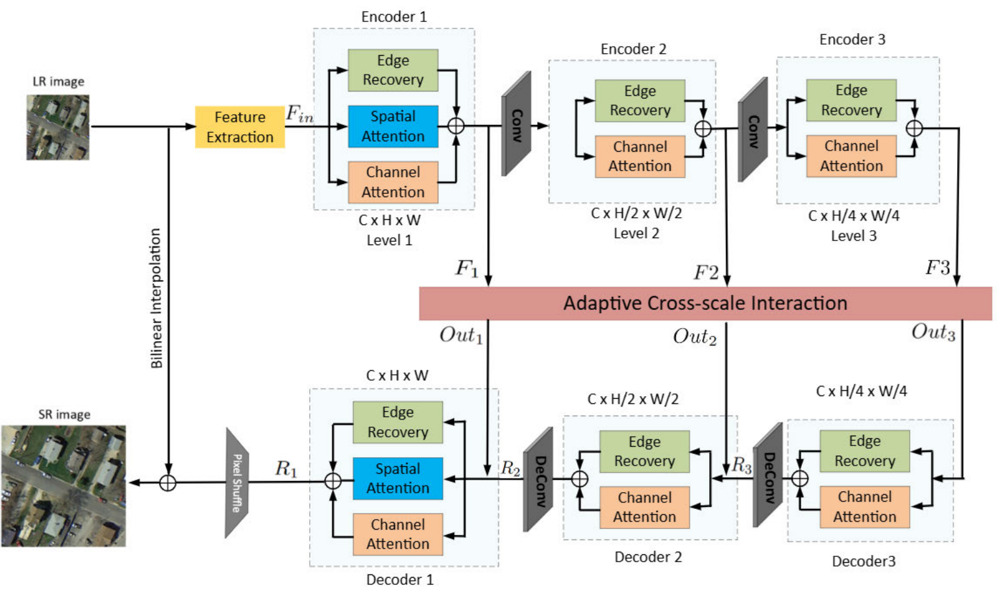

# AERU-Net: Adaptive Edge Recovery and Attention U-Shaped Network for Remote Sensing Image Super-Resolution

[](https://doi.org/10.1109/ACCESS.2025.3556312)

Official PyTorch implementation of the paper:

> **AERU-Net: Adaptive Edge Recovery and Attention U-Shaped Network for Remote Sensing Image Super-Resolution**
> Amir Hajian<sup>1</sup> (Member, IEEE) and Supavadee Aramvith<sup>2</sup> (Senior Member, IEEE)
> *IEEE Access*, vol. 13, pp. 59177–59197, 2025. DOI: [10.1109/ACCESS.2025.3556312](https://doi.org/10.1109/ACCESS.2025.3556312)
>
> <sup>1</sup> Department of Electrical Engineering, Faculty of Engineering, Chulalongkorn University, Bangkok 10330, Thailand
> <sup>2</sup> Multimedia Data Analytics and Processing Research Unit, Department of Electrical Engineering, Faculty of Engineering, Chulalongkorn University, Bangkok 10330, Thailand
>
> Received 2 March 2025 · Accepted 25 March 2025 · Published 31 March 2025

## Abstract

Remote sensing image super-resolution (RSISR) has recently garnered significant attention, with major advances achieved through deep learning neural networks. Remote sensing images (RSIs) contain rich, recurring textural and structural patterns that vary substantially across different classes of RSIs. While state-of-the-art RSISR methods have begun incorporating attention mechanisms to explore and recover multi-scale global features, they face challenges in identifying the most relevant details and recovering complex edge patterns. In this research, we propose a novel Adaptive Edge Recovery and Attention U-shaped Network (AERU-Net), which integrates an Edge Recovery Block (ERB), Channel Attention Module (CAM) and Spatial Attention Module (SAM) within a three-level encoder-decoder architecture. Furthermore, we introduce a novel adaptive Cross-scale Interaction (CSI) module along with a Laplacian Edge Preserver (LEP) block to connect encoders and decoders across different network scales (levels). Our design facilitates the gradual acquisition of contextual information while enhancing the retention of high-frequency edge details. Performance analysis conducted on four RSI datasets (UCMerced, RSSCN7, AID, and WHU-RS19) in three up-sampling scales (×2, ×3, and ×4) demonstrates that AERU-Net achieves significant improvements over state-of-the-art models in PSNR, SSIM, SCC, and SAM. Our model strikes an effective balance between accuracy and network complexity.

**Index terms:** adaptive cross-scale interaction, attention mechanism, deep learning, edge recovery, remote sensing image super-resolution.

## Architecture



*Figure 1 of the paper: the architecture of AERU-Net. Reproduced from the paper under the [CC BY 4.0](https://creativecommons.org/licenses/by/4.0/) license.*

AERU-Net is a three-level U-shaped encoder–decoder network:

- **Shallow feature extraction.** A 3×3 convolution maps the RGB LR input to features F<sub>in</sub> ∈ ℝ<sup>H×W×C</sup>.
- **Encoders.** Each level down-samples by ×2 with a stride-2 2×2 convolution, so F<sub>i</sub> = Enc<sub>i</sub>(Conv<sub>2×2</sub>(F<sub>i−1</sub>)) for i = 2, 3. The level-1 encoder and decoder combine the **Edge Recovery Block (ERB)**, **Spatial Attention Module (SAM)** and **Channel Attention Module (CAM)**: Y′ = ERB(Q, K, V) + CAM(Q, K, V) + SAM(Q, K, V) + X. Levels 2 and 3 use ERB and CAM only, because spatial information becomes less complete and edges and channels become more abstract at deeper levels: Y′ = ERB(Q, K, V) + CAM(Q, K, V) + X. Q, K and V come from a 1×1 convolution followed by a 3×3 depth-wise convolution. A ReLU is applied before the Softmax in the attention. Each block ends with a feed-forward network: normalization, then two 1×1 convolutions with a SimpleGate between them.
- **Adaptive Cross-scale Interaction (CSI).** CSI replaces plain skip connections: [Out<sub>1</sub>, Out<sub>2</sub>, Out<sub>3</sub>] = CSI(F<sub>1</sub>, F<sub>2</sub>, F<sub>3</sub>). Each level keeps its own query. The keys and values of all three levels are reshaped, concatenated and passed through an adaptive shared block (K<sub>sh</sub>, V<sub>sh</sub>), which lets information flow across levels.
- **Laplacian Edge Preserver (LEP).** Inside CSI, LEP filters features with parallel 3×3 and 5×5 Laplacian filters (Z = Lap<sub>5×5</sub>(F) + Lap<sub>3×3</sub>(F)), normalizes and concatenates them, then applies a convolution and a PReLU. The result is fused step by step with the CAM output to keep scale-specific edge information.
- **Decoders and reconstruction.** Each decoder level up-samples with a 2×2 deconvolution and adds the matching CSI output. A final pixel-shuffle produces the SR image. The bilinearly up-sampled LR input is added to it as a global residual.

Configuration used in the paper: encoder blocks **[4, 3, 1]**, decoder blocks **[1, 1, 1]**, **64** channels.

The network is defined in [`codes/model/areunet.py`](codes/model/areunet.py). Select it with `--model areunet`.

### Contributions

1. **Edge Recovery Blocks (ERB)** integrated with attention blocks in the encoders and decoders at every level of the U-shaped framework, improving spatial and edge recovery in hierarchical multi-scale features.
2. An **adaptive Cross-scale Interaction (CSI)** technique that uses scale-specific attention to pass information in both directions between the encoders and decoders at each level.
3. A **Laplacian Edge Preserver (LEP)** block inside CSI that preserves structural information at each scale while the encoders and decoders interact.

## Datasets

HR images are the references. LR images are generated from them by bicubic interpolation.

| Dataset | Images | Classes | Image size | Split |
|---|---|---|---|---|
| UCMerced | 2,100 | 21 | 256×256 | 50% train / 50% test (1,050 each); 20% of training data for validation |
| RSSCN7 | 2,800 | 7 | 400×400 | 50% train / 50% test (1,400 each); 20% of training data for validation |
| AID | 10,000 | 30 | 600×600 | 80% train (5 images per class for validation) / 20% test |
| WHU-RS19 | 1,005 | 19 | 600×600 | Test only; complements the AID test set |

Evaluation metrics: **PSNR**, **SSIM**, **SCC** (spatial correlation coefficient) and **SAM** (spectral angle mapper). Higher is better for PSNR, SSIM and SCC; lower is better for SAM.

## Implementation details (from the paper)

| Setting | Value |
|---|---|
| Training patches | Random 48×48 LR patches with the matching HR patches |
| Loss | L1 |
| Optimizer | Adam (β1 = 0.9, β2 = 0.999, ε = 1e-8) |
| Learning rate | 8e-4, decayed to 1e-7 over 2000 epochs (cosine annealing) |
| Batch size | 16 |
| Epochs | 2000 |
| Encoder / decoder blocks | [4, 3, 1] / [1, 1, 1] |
| Channels | 64 |
| Hardware | PyTorch, NVIDIA GeForce RTX 4090 (24 GB), Intel Core i7-14700 |

These are the defaults in `codes/option.py` and the training scripts.

## Results

### Comparison with state-of-the-art methods (Table 2 of the paper)

AERU-Net results. The paper compares against SRCNN, VDSR, DCM, MHAN, HSENet, TransENet, SRDD, FENet, Omni-SR, CSA-FE and HAUNet-S.

| Dataset | Scale | PSNR ↑ | SSIM ↑ | SCC ↑ | SAM ↓ |
|---|:-:|:-:|:-:|:-:|:-:|
| UCMerced | ×2 | 34.64 | 0.9346 | 0.6514 | 0.0478 |
| UCMerced | ×3 | 30.30 | 0.8492 | 0.4251 | 0.0781 |
| UCMerced | ×4 | 27.97 | 0.7686 | 0.2842 | 0.1007 |
| RSSCN7 | ×2 | 30.21 | 0.8087 | 0.3101 | 0.0998 |
| RSSCN7 | ×3 | 28.09 | 0.7081 | 0.1602 | 0.1285 |
| RSSCN7 | ×4 | 26.88 | 0.6407 | 0.0918 | 0.1471 |
| AID | ×2 | 35.57 | 0.9387 | 0.6639 | 0.0521 |
| AID | ×3 | 31.55 | 0.8605 | 0.4088 | 0.0804 |
| AID | ×4 | 29.43 | 0.7894 | 0.2886 | 0.1007 |
| WHU-RS19 | ×2 | 30.24 | 0.8274 | 0.3102 | 0.0855 |
| WHU-RS19 | ×3 | 27.87 | 0.7326 | 0.1880 | 0.1132 |
| WHU-RS19 | ×4 | 26.43 | 0.6641 | 0.1228 | 0.1340 |

On UCMerced ×4, AERU-Net has the highest PSNR in 18 of the 21 classes.

### Ablation study (Table 1 of the paper, PSNR in dB)

| ERB | CSI | LEP | UCMerced ×2 | ×3 | ×4 | RSSCN7 ×2 | ×3 | ×4 | AID ×2 | ×3 | ×4 |
|:-:|:-:|:-:|:-:|:-:|:-:|:-:|:-:|:-:|:-:|:-:|:-:|
| ✓ | ✗ | ✗ | 33.97 | 29.81 | 27.52 | 30.04 | 27.79 | 26.71 | 35.29 | 30.98 | 29.03 |
| ✓ | ✗ | ✓ | 34.59 | 30.26 | 27.91 | 30.17 | 28.02 | 26.86 | 35.53 | 31.51 | 29.39 |
| ✗ | ✓ | ✓ | 34.08 | 29.89 | 27.57 | 30.09 | 27.87 | 26.73 | 35.35 | 31.17 | 29.12 |
| ✓ | ✓ | ✗ | 34.28 | 30.03 | 27.65 | 30.11 | 27.93 | 26.78 | 35.39 | 31.29 | 29.16 |
| ✓ | ✓ | ✓ | **34.64** | **30.30** | **27.97** | **30.21** | **28.09** | **26.88** | **35.57** | **31.55** | **29.43** |

### Complexity (Table 6 of the paper, UCMerced ×4)

| Model | Params | Memory | FLOPs | Time | PSNR / SSIM |
|---|:-:|:-:|:-:|:-:|:-:|
| SRCNN | 69K | 40MB | 4.53G | 0.36ms | 26.92 / 0.7286 |
| VDSR | 671K | 614MB | 44.03G | 10.95ms | 27.54 / 0.7522 |
| DCM | 2.17M | 124MB | 13.00G | 2.94ms | 27.60 / 0.7556 |
| MHAN | 11.50M | 596MB | 67.88G | 27.02ms | 27.63 / 0.7581 |
| HSENet | 5.43M | 1668MB | 19.20G | 33.74ms | 27.75 / 0.7611 |
| TransENet | 37.46M | 734MB | 21.44G | 29.41ms | 27.78 / 0.7635 |
| SRDD | 9.34M | 244MB | 6.46G | 35.15ms | 27.67 / 0.7609 |
| FENet | 366K | 102MB | 1.44G | 18.57ms | 27.59 / 0.7538 |
| CSA-FE | 32.35M | 703MB | 18.44G | 31.51ms | 27.71 / 0.7645 |
| Omni-SR | 793K | 1084MB | 3.15G | 34.44ms | 27.80 / 0.7637 |
| HAUNet-S | 596K | 1192MB | 1.90G | 19.04ms | 27.92 / 0.7680 |
| **AERU-Net (ours)** | 706K | 1213MB | 1.94G | 19.46ms | **27.97 / 0.7686** |

## Repository structure

```
aeru-net/
├── codes/
│   ├── demo_train.py          # training / testing entry point
│   ├── demo_deploy.py         # super-resolve a folder of images
│   ├── option.py              # all command-line options
│   ├── trainer.py, utils.py   # training loop, checkpointing, PSNR/SSIM
│   ├── data/                  # UCMerced dataset loader
│   ├── model/areunet.py       # AERU-Net
│   ├── loss/                  # L1 (default), MSE, VGG, GAN losses
│   ├── calculate_metric.py    # PSNR / SSIM / SAM / QI / SCC on saved SR images
│   ├── metric_scripts/        # additional metric scripts (Python / MATLAB)
│   └── train_ucm_x*.sh, test_ucm_x*.sh
├── figs/architecture.png
└── pretrained/
    └── aerunet_ucmerced_x3.pt # AERU-Net weights, UCMerced ×3
```

## Requirements

- Python 3.8+
- PyTorch with CUDA

```bash
pip install -r requirements.txt
```

`sewar` is only needed for `calculate_metric.py`, and `thop` only for the FLOPs benchmark in `model/areunet.py`.

## Dataset preparation

By default the UCMerced loader reads `.tif` images from `codes/datasets/UCMerced-dataset`, laid out as follows:

```
codes/datasets/UCMerced-dataset/
├── train/  HR_x2/  LR_x2/  HR_x3/  LR_x3/  HR_x4/  LR_x4/
├── val/    HR_x2/  LR_x2/  ...
└── test/   HR_x2/  LR_x2/  ...
```

Each LR image is the bicubic-downsampled version of the HR image with the same file name. To keep the data somewhere else, pass `--dir_data /path/to/UCMerced-dataset`.

## Training

Run from the `codes/` directory:

```bash
cd codes
bash train_ucm_x3.sh                 # ×3 (runs in the background, log in train_ucm_x3.out)
bash train_ucm_x4.sh                 # ×4
bash train_ucm_x4.sh --resume 1      # continue the ×4 run from its last epoch
```

Or call the entry point directly. `--patch_size` is the HR patch size; set it to 48 × scale so the LR patch is 48×48, as in the paper:

| Scale | `--patch_size` |
|:-:|:-:|
| ×2 | 96 |
| ×3 | 144 |
| ×4 | 192 |

```bash
python demo_train.py --model areunet --dataset UCMerced --scale 2 --patch_size 96 --save AERUNet_UCMerced_x2
```

Run `python demo_train.py --help` for all options. Logs, plots and checkpoints are written to `experiment/<save>/`. The scripts call `python`; to use another interpreter, set `PYTHON`, for example `PYTHON=~/miniconda3/envs/aerunet/bin/python bash train_ucm_x3.sh`.

## Testing

```bash
cd codes
bash test_ucm_x3.sh    # evaluates pretrained/aerunet_ucmerced_x3.pt on the UCMerced ×3 test set
```

The script prints PSNR and SSIM for each image and the averages over the test set (RGB, with a border of `scale` pixels cropped). SR images are saved to `experiment/AERUNet_UCMerced_x3/results/`. `test_ucm_x4.sh` does the same for ×4 using a checkpoint trained with `train_ucm_x4.sh`.

To compute PSNR, SSIM, SAM, QI and SCC on the saved SR images, edit the folders at the top of `calculate_metric.py` and run:

```bash
python calculate_metric.py
```

## Super-resolving your own images

```bash
cd codes
python demo_deploy.py --model areunet --scale 3 --patch_size 144 \
    --pre_train ../pretrained/aerunet_ucmerced_x3.pt \
    --dir_data /path/to/lr_pngs --dir_out ../experiment/results/my_sr
```

The model processes LR tiles of size `patch_size / scale`, so each input image must be at least that large.

## Citation

If you find this work useful, please cite:

```bibtex
@article{hajian2025aerunet,
  author  = {Hajian, Amir and Aramvith, Supavadee},
  title   = {{AERU-Net}: Adaptive Edge Recovery and Attention U-Shaped Network for Remote Sensing Image Super-Resolution},
  journal = {IEEE Access},
  volume  = {13},
  pages   = {59177--59197},
  year    = {2025},
  doi     = {10.1109/ACCESS.2025.3556312}
}
```

## Acknowledgements

This research is supported by the Ratchadapisek Somphot Fund for Postdoctoral Fellowship, Chulalongkorn University, and in part by the Thailand Science Research and Innovation Fund, Chulalongkorn University, under Grant IND_FF_68_280_2100_039. The authors thank the Department of Electrical Engineering, Faculty of Engineering, Chulalongkorn University.

This code builds on [HAUNet](https://github.com/likakakaka/HAUNet_RSISR) and uses components from [Omni-SR](https://github.com/Francis0625/Omni-SR) (`codes/model/ops/`) and [BasicSR](https://github.com/XPixelGroup/BasicSR) (metric scripts). We thank their authors for releasing their code.

## Contact

Corresponding author: Supavadee Aramvith (supavadee.a@chula.ac.th)
